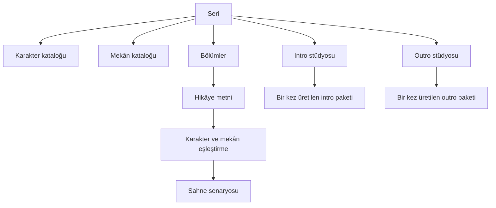

# Bağımsız hikâyeden senaryo üretim ürünü — mimari ve uygulama planı

## 1. Amaç

Mevcut uygulama ve üretim hattı değiştirilmeden kenarda tutulacaktır. Yeni ürün, mevcut koddan yalnızca çalışan teknik yaklaşımlar için yararlanacak ve bağımsız çalışacaktır.

Yeni ürünün amacı bir hikâye metninden aşağıdaki kalıcı çıktıları üretmektir:

1. Hikâyedeki karakterler ve ayrıntılı tanımları
2. Hikâyedeki mekânlar ve ayrıntılı tanımları
3. Bölüm sahneleri
4. Seriye ait bağımsız intro
5. Seriye ait bağımsız outro

Intro ve outro senaryo oluşturulurken otomatik olarak üretilmeyecektir. Her biri ayrı ekrandan, ayrı komutla ve ayrı üretim durumu ile üretilecektir. Üretilen seri varlıkları sonraki bölümlerde yeniden oluşturulmadan kullanılacaktır.

---

## 2. Kapsam

Yeni sistem beş bağımsız ürün alanından oluşacaktır:

```text
Seri yönetimi
├── Karakter kataloğu
├── Mekân kataloğu
├── Bölüm senaryoları
├── Intro stüdyosu
└── Outro stüdyosu
```

Her alan ayrı kaydedilecek ve diğer alanların yeniden üretilmesini gerektirmeyecektir.

### Bu aşamanın içinde

- Yeni seri oluşturma ve mevcut seriyi seçme
- Hikâye metni yükleme veya yazma
- Karakterleri çıkarma, düzenleme ve onaylama
- Mekânları çıkarma, düzenleme ve onaylama
- Onaylı kataloglardan sahne üretme
- Senaryoyu elle veya yapay zekâ ile düzeltme
- Intro tanımını bağımsız oluşturma
- Intro görsel/video/ses varlıklarını bağımsız üretme veya dışarıdan yükleme
- Outro tanımını bağımsız oluşturma
- Outro görsel/video/ses varlıklarını bağımsız üretme veya dışarıdan yükleme
- Seri varlıklarını kilitleme ve sonraki bölümlerde tekrar kullanma
- JSON ve ZIP dışa aktarma

### Bu aşamanın dışında

- Bölüm sahnelerinden final video üretme
- Bölüm seslendirmesi
- Bölüm altyazısı
- Mevcut `arayuz.py` ve `uretim.py` akışını değiştirme
- Veritabanı
- Genel provider/factory/plugin mimarisi

---

## 3. Ana mimari kararı: seri ve bölüm ayrımı

Karakter, mekân, intro ve outro **seri seviyesinde**; sahneler ise **bölüm seviyesinde** saklanacaktır.



Bir bölüm yalnızca şu kimlikleri referans edecektir:

```json
{
  "series_id": "pamukiko_masallari",
  "intro_id": "series_intro",
  "outro_id": "series_outro"
}
```

Intro ve outro tanımlarının tamamı her bölümün `senaryo.json` dosyasına kopyalanmayacaktır.

---

## 4. Mevcut yapıdan alınacak ve alınmayacak parçalar

### Yalnızca yaklaşım olarak yararlanılacak parçalar

| Mevcut dosya | Yararlanılacak yaklaşım |
|---|---|
| `senaryo.py` | Claude çağrısı, yalnızca JSON isteme, JSON temizleme |
| `planlar.py` | Pydantic ile çıktı sözleşmesi ve doğrulama |
| `proje.py` | Güvenli dosya/klasör kimliği üretme |
| `karakterler.py` | Kalıcı kimlik, kıyafet, kişilik ve ses özelliklerini ayırma |
| `uretim.py` | Dosya varsa yeniden üretmeme ve medya doğrulama yaklaşımı |

### Yeni ürüne bağlanmayacak parçalar

- Mevcut `hikaye/` proje düzeni
- Mevcut global `ana_karakterler.txt`
- Mevcut içerik türüne bağlı `varliklar/cocuk_masali/` yapısı
- Mevcut tam otomatik medya üretim bandı
- Mevcut Streamlit oturum durumu

Yeni ürünün verisi `seriler/` altında bağımsız tutulacaktır.

---

## 5. Depolama düzeni

```text
seriler/
└── pamukiko_masallari/
    ├── seri.json
    ├── karakterler.json
    ├── mekanlar.json
    ├── intro/
    │   ├── intro.json
    │   ├── reference.png
    │   ├── intro.mp4
    │   ├── audio.wav
    │   └── status.json
    ├── outro/
    │   ├── outro.json
    │   ├── reference.png
    │   ├── outro.mp4
    │   ├── audio.wav
    │   └── status.json
    └── bolumler/
        ├── 001_pamuk_ve_kiko/
        │   ├── hikaye.txt
        │   └── senaryo.json
        └── 002_kayip_tohum/
            ├── hikaye.txt
            └── senaryo.json
```

### Depolama ilkeleri

- Her seri benzersiz bir `series_id` ile tanımlanır.
- Intro ve outro klasörleri birbirinden tamamen bağımsızdır.
- Intro üretimi başarısız olursa outro etkilenmez.
- Outro üretimi başarısız olursa intro etkilenmez.
- Yeni bölüm oluşturmak intro/outro dosyalarına yazmaz.
- Üretilmiş medya dosyaları otomatik olarak üzerine yazılmaz.
- Yeniden üretme yalnızca açık kullanıcı onayıyla yeni revizyon olarak yapılır.

---

## 6. Seri modeli

`seri.json` serinin değişmeyen temel kimliğini tutacaktır.

```json
{
  "schema_version": 1,
  "series_id": "pamukiko_masallari",
  "name": "Pamukiko Masalları",
  "description": "Pamuk ve Kiko'nun eğitici orman maceraları",
  "target_audience": "5-7 yaş",
  "language": "tr",
  "visual_style": "Sinematik 3D animasyon, yumuşak ışık, canlı renkler",
  "default_aspect_ratio": "16:9",
  "created_at": "2026-09-26T00:00:00Z"
}
```

### Kurallar

- `series_id` oluşturulduktan sonra değiştirilemez.
- Seri adı değişse bile dosya yolları bozulmaz.
- Intro ve outro bu kimliğe bağlanır.
- İçerik türü seri kimliği yerine kullanılamaz.

---

## 7. Ürün 1 — Karakter kataloğu

`karakterler.json`, hikâyelerde kullanılan tüm karakterlerin kalıcı kimliğini tutacaktır.

```json
{
  "series_id": "pamukiko_masallari",
  "characters": [
    {
      "character_id": "pamuk",
      "name": "Pamuk",
      "aliases": [],
      "type": "Tavşan",
      "role": "main",
      "first_seen_episode": 1,
      "visual_identity": {
        "body": "Küçük ve yuvarlak gövdeli",
        "fur_or_skin": "Beyaz post",
        "face": "Sevimli yuvarlak yüz",
        "eyes": "Büyük mavi gözler",
        "distinctive_features": "Uzun pembe iç kulaklar"
      },
      "default_clothing": "Pembe askılı elbise ve küçük fiyonk",
      "personality": [
        "utangaç",
        "yardımsever",
        "sevimli"
      ],
      "speech_style": "Kısa, nazik ve yumuşak cümleler",
      "voice_description": "Yumuşak ve tatlı çocuk sesi",
      "consistency_rules": [
        "Post rengi değişmez",
        "Göz rengi değişmez",
        "Varsayılan kıyafeti değişmez"
      ]
    }
  ]
}
```

### Karakter kuralları

- Kalıcı kimlik ile sahne durumu ayrılacaktır.
- “Pamuk beyaz tavşandır” kalıcı kimliktir.
- “Pamuk bu sahnede çamura bulanmıştır” sahne durumudur.
- Mevcut karakter tanımları yeni hikâye işlenirken yeniden yazılamaz.
- Yapay zekâ yalnızca yeni karakter adayı önerebilir.
- Yeni karakter kullanıcı onayından sonra kataloğa eklenir.
- `main`, `recurring`, `supporting` ve `guest` rolleri desteklenir.
- Yeni karakter eklenmesi intro veya outroyu otomatik değiştirmez.

---

## 8. Ürün 2 — Mekân kataloğu

`mekanlar.json`, serinin kalıcı mekân kimliklerini tutacaktır.

```json
{
  "series_id": "pamukiko_masallari",
  "locations": [
    {
      "location_id": "buyulu_orman",
      "name": "Büyülü Orman",
      "aliases": [
        "orman"
      ],
      "first_seen_episode": 1,
      "visual_identity": {
        "environment": "Büyük, yuvarlak gövdeli ağaçlarla çevrili orman",
        "ground": "Yumuşak çimen ve renkli küçük çiçekler",
        "landmarks": [
          "Ortadaki büyük meşe ağacı",
          "Taşlarla çevrili küçük dere"
        ],
        "color_palette": [
          "canlı yeşil",
          "sıcak sarı",
          "açık mavi"
        ],
        "default_lighting": "Yumuşak sabah ışığı",
        "atmosphere": "Güvenli, neşeli ve masalsı"
      },
      "consistency_rules": [
        "Büyük meşe ağacının konumu değişmez",
        "Mekân korkutucu gösterilmez"
      ]
    }
  ]
}
```

### Mekân kuralları

- Kalıcı yapı katalogda tutulur.
- Hava, saat, ışık ve geçici nesneler sahne içinde tutulur.
- Aynı ad veya takma ad mevcut bir mekânla eşleşirse yeni kayıt açılmaz.
- Yeni mekânlar kullanıcı onayından sonra eklenir.
- Yeni mekân eklenmesi intro veya outroyu otomatik değiştirmez.

---

## 9. Ürün 3 — Bölüm sahneleri

Her bölüm için bağımsız `senaryo.json` oluşturulacaktır.

```json
{
  "schema_version": 1,
  "series_id": "pamukiko_masallari",
  "episode": {
    "episode_no": 3,
    "title": "Pamuk ve Kayıp Tohum",
    "summary": "Pamuk ve Kiko kayıp tohumu bulup bahçeye eker.",
    "moral": "Sabır ve yardımlaşma"
  },
  "intro_id": "series_intro",
  "outro_id": "series_outro",
  "scenes": [
    {
      "scene_id": "scene_001",
      "order": 1,
      "title": "Pamuk tohumu fark eder",
      "source_excerpt": "Pamuk bahçede küçük bir tohum buldu.",
      "location_id": "sebze_bahcesi",
      "character_ids": [
        "pamuk",
        "kiko"
      ],
      "character_states": {
        "pamuk": {
          "emotion": "meraklı",
          "action": "Toprağın yanına eğilmiş",
          "temporary_clothing": null
        },
        "kiko": {
          "emotion": "şaşkın",
          "action": "Pamuk'un yanında uçuyor",
          "temporary_clothing": null
        }
      },
      "location_state": {
        "time_of_day": "sabah",
        "weather": "güneşli",
        "temporary_details": [
          "Toprakta küçük bir çukur"
        ]
      },
      "story_event": "Pamuk toprağın üzerinde küçük bir tohum görür.",
      "narration": "Pamuk, bahçede daha önce görmediği küçük bir tohum buldu.",
      "dialogue": [
        {
          "character_id": "pamuk",
          "line": "Kiko, bu küçük tohum nereden geldi?"
        }
      ],
      "visual_description": "Pamuk toprağın yanına eğilmiş, Kiko onun üzerinde merakla uçuyor.",
      "estimated_duration_sec": 10
    }
  ]
}
```

### Sahne kuralları

- Hikâyedeki olay sırası korunur.
- Kaynakta olmayan olay veya karakter eklenmez.
- Her sahne tek ana olaya odaklanır.
- Her `character_id`, karakter kataloğunda bulunur.
- Her `location_id`, mekân kataloğunda bulunur.
- Kalıcı özellikler sahne içinde yeniden tanımlanmaz.
- Intro ve outro sahne listesine kopyalanmaz.
- `source_excerpt`, sahnenin kaynak hikâyedeki karşılığını gösterir.
- Senaryo elle düzenlendikten sonra tekrar doğrulanır.

---

## 10. Ürün 4 — Bağımsız intro stüdyosu

Intro, hikâyeden senaryo üretiminin bir alt adımı olmayacaktır. Kullanıcı istediği zaman intro stüdyosunu açıp seçilen seri için intro oluşturabilecektir.

### Intro girdileri

- Seri
- Introda görünecek ana karakterler
- Kullanılacak mekân
- Süre
- Sabit seri başlığı
- Karakterlerin hareketi
- Görsel tarz
- Ses seçeneği
- İsteğe bağlı dışarıdan görsel, video veya ses

### Intro tanımı

`intro/intro.json`:

```json
{
  "schema_version": 1,
  "intro_id": "series_intro",
  "series_id": "pamukiko_masallari",
  "revision": 1,
  "status": "draft",
  "duration_sec": 5,
  "character_ids": [
    "pamuk",
    "kiko"
  ],
  "location_id": "buyulu_orman",
  "visual_description": "Pamuk ve Kiko büyük meşe ağacının önünde izleyiciyi karşılar.",
  "action_description": "Pamuk el sallar, Kiko kısa bir daire çizerek yanına konar.",
  "fixed_text": "Pamukiko Masalları",
  "audio_description": "Kısa ve kolay hatırlanan neşeli seri melodisi",
  "generation": {
    "image_source": "generated",
    "video_source": "generated",
    "audio_source": "uploaded"
  }
}
```

### Intro bağımsız üretim akışı

```text
Intro tanımını oluştur/düzenle
        ↓
Tanımı onayla
        ↓
Referans görsel üret veya yükle
        ↓
Intro videosu üret veya yükle
        ↓
Jingle üret veya yükle
        ↓
Medya dosyalarını doğrula
        ↓
Introyu kilitle
```

### Intro kuralları

- Intro yalnızca kullanıcı “Intro üret” dediğinde çalışır.
- Senaryo üretmek intro üretimini tetiklemez.
- Outro üretmek intro üretimini tetiklemez.
- Kilitli ve geçerli `intro.mp4` varsa yeni bölümlerde aynen kullanılır.
- Bölüm adı, bölüm özeti veya bölüm numarası sabit intronun içine yazılmaz.
- Yeni karakter eklenmesi introyu otomatik değiştirmez.
- Mevcut intro üzerine otomatik yazılmaz.
- Değişiklik gerektiğinde `revision: 2` oluşturulur; eski revizyon korunur.

### Intro tamamlanma kriteri

Intro ancak aşağıdakiler sağlandığında `locked` olabilir:

- `intro.json` doğrulanmış
- Seçilen karakter ve mekân kimlikleri katalogda mevcut
- `intro.mp4` mevcut ve `ffprobe` doğrulamasından geçmiş
- Seçilmişse ses dosyası mevcut ve okunabilir
- Süre pozitif

---

## 11. Ürün 5 — Bağımsız outro stüdyosu

Outro da introdan ve senaryo üretiminden bağımsız çalışacaktır.

### Outro girdileri

- Seri
- Outroda görünecek karakterler
- Kullanılacak mekân
- Süre
- Sabit veda metni
- Sabit çağrı metni
- Karakterlerin veda hareketi
- Ses seçeneği
- İsteğe bağlı dışarıdan görsel, video veya ses

### Outro tanımı

`outro/outro.json`:

```json
{
  "schema_version": 1,
  "outro_id": "series_outro",
  "series_id": "pamukiko_masallari",
  "revision": 1,
  "status": "draft",
  "duration_sec": 7,
  "character_ids": [
    "pamuk",
    "kiko"
  ],
  "location_id": "buyulu_orman",
  "visual_description": "Pamuk ve Kiko izleyiciye gülümseyerek el sallar.",
  "action_description": "Karakterler sabit kadrajda vedalaşır.",
  "fixed_text": "Yeni bir macerada görüşmek üzere!",
  "call_to_action": "Yeni masallar için bizi takip edebilirsiniz.",
  "audio_description": "Intro melodisinin yumuşak kapanış sürümü",
  "generation": {
    "image_source": "generated",
    "video_source": "generated",
    "audio_source": "uploaded"
  }
}
```

### Outro bağımsız üretim akışı

```text
Outro tanımını oluştur/düzenle
        ↓
Tanımı onayla
        ↓
Referans görsel üret veya yükle
        ↓
Outro videosu üret veya yükle
        ↓
Kapanış sesi üret veya yükle
        ↓
Medya dosyalarını doğrula
        ↓
Outroyu kilitle
```

### Outro kuralları

- Outro yalnızca kullanıcı “Outro üret” dediğinde çalışır.
- Senaryo üretmek outroyu tetiklemez.
- Intro üretmek outroyu tetiklemez.
- Kilitli ve geçerli `outro.mp4` sonraki bölümlerde aynen kullanılır.
- Sonraki bölüm tanıtımı gibi değişken metinler sabit outroyu değiştirmez.
- Bölüme özel metin gerekiyorsa ileride final video aşamasında ayrı katman olarak eklenir.
- Yeni karakter eklenmesi outroyu otomatik değiştirmez.
- Yeniden üretim yeni revizyon açar; mevcut dosyanın üzerine yazmaz.

### Outro tamamlanma kriteri

Outro ancak aşağıdakiler sağlandığında `locked` olabilir:

- `outro.json` doğrulanmış
- Seçilen karakter ve mekân kimlikleri katalogda mevcut
- `outro.mp4` mevcut ve `ffprobe` doğrulamasından geçmiş
- Seçilmişse ses dosyası mevcut ve okunabilir
- Süre pozitif

---

## 12. Intro ve outro durum modeli

Her ikisi aynı basit yaşam döngüsünü kullanacaktır:

```text
draft → approved → producing → ready → locked
                    ↘ failed
```

| Durum | Anlamı |
|---|---|
| `draft` | Tanım düzenlenebilir |
| `approved` | Tanım üretime hazır |
| `producing` | Medya üretimi devam ediyor |
| `ready` | Dosyalar üretildi ve doğrulandı |
| `locked` | Seri bölümlerinde kullanılabilir, otomatik değiştirilemez |
| `failed` | Üretim başarısız; hata kaydı gösterilir |

Intro ve outro için ayrı `status.json` kullanılacaktır. Birinin durumu diğerini etkilemeyecektir.

---

## 13. Hikâyeden senaryo üretim iş akışı

### Adım 1 — Seri seçimi

- Kullanıcı mevcut seri seçer veya yeni seri oluşturur.
- Seri kimliği bölüm oluşturulmadan önce kesinleşir.

### Adım 2 — Hikâye girişi

- Metin alanına yapıştırma veya `.txt` yükleme
- Bölüm numarası ve başlığı
- Boş veya yalnızca boşluk içeren hikâyeyi reddetme

### Adım 3 — Karakter ve mekân çıkarımı

İlk yapay zekâ çağrısı yalnızca şunları üretir:

- Hikâyede bulunan karakterler
- Hikâyede bulunan mekânlar
- Mevcut katalog eşleşmeleri
- Yeni kayıt adayları

Örnek:

```text
Pamuk → mevcut: pamuk
Kiko → mevcut: kiko
Mavi Kuş → yeni karakter adayı
Orman → mevcut: buyulu_orman
Bahçe → yeni mekân adayı
```

### Adım 4 — Kullanıcı onayı

- Mevcut eşleşmeler kontrol edilir.
- Yeni adayların ayrıntıları düzenlenir.
- Onaylanan kayıtlar kataloglara eklenir.
- Mevcut kayıtlar yapay zekâ tarafından değiştirilemez.

### Adım 5 — Sahne üretimi

İkinci yapay zekâ çağrısına yalnızca şunlar verilir:

- Kaynak hikâye
- Seri bilgisi
- Onaylı karakter kataloğu
- Onaylı mekân kataloğu
- Sahne JSON sözleşmesi

### Adım 6 — Doğrulama ve düzenleme

- Karakter ve mekân referansları doğrulanır.
- Hikâye sırası kontrol edilir.
- Kullanıcı sahneleri elle düzenleyebilir.
- İstenirse kullanıcı talimatıyla yapay zekâ düzeltmesi yapılabilir.
- Düzeltilmiş sonuç kaydedilmeden tekrar doğrulanır.

### Adım 7 — Kayıt ve dışa aktarma

- Kaynak hikâye saklanır.
- `senaryo.json` atomik olarak yazılır.
- JSON dosyaları ayrı ayrı veya ZIP paketi olarak indirilebilir.

---

## 14. Arayüz planı

Yeni bağımsız uygulama:

```bash
streamlit run senaryo_studyo.py
```

Önerilen üst navigasyon:

1. **Seriler**
2. **Karakterler**
3. **Mekânlar**
4. **Hikâyeden senaryo**
5. **Intro stüdyosu**
6. **Outro stüdyosu**
7. **Dışa aktar**

### Seriler

- Yeni seri oluşturma
- Mevcut seri seçme
- Seri bilgilerini düzenleme
- Intro/outro hazır durumunu görüntüleme

### Karakterler

- Karakter kataloğunu görüntüleme
- Yeni karakter ekleme
- Taslak karakteri düzenleme
- Onaylı karakterlerde kontrollü değişiklik

### Mekânlar

- Mekân kataloğunu görüntüleme
- Yeni mekân ekleme
- Taslak mekânı düzenleme
- Mevcut mekân takma adlarını yönetme

### Hikâyeden senaryo

- Hikâye metni
- Karakter/mekân çıkarımı
- Aday onayı
- Sahne üretimi
- Sahne düzenleme
- Senaryo indirme

### Intro stüdyosu

- Intro tanımını bağımsız düzenleme
- Görsel üretme veya yükleme
- Video üretme veya yükleme
- Ses üretme veya yükleme
- Önizleme
- Kilitleme
- Yeni revizyon oluşturma

### Outro stüdyosu

- Outro tanımını bağımsız düzenleme
- Görsel üretme veya yükleme
- Video üretme veya yükleme
- Ses üretme veya yükleme
- Önizleme
- Kilitleme
- Yeni revizyon oluşturma

### Dışa aktar

- `seri.json`
- `karakterler.json`
- `mekanlar.json`
- Bölüm `senaryo.json` dosyaları
- Intro paketi
- Outro paketi
- Tüm seriyi ZIP olarak indirme

---

## 15. Teknik dosya planı

Mevcut uygulama dosyaları değiştirilmeden yeni dosyalar oluşturulacaktır.

```text
senaryo_studyo.py
senaryo_modelleri.py
seri_deposu.py
senaryo_motoru.py
intro_studyo.py
outro_studyo.py
medya_dogrulama.py
app_pages/
├── seriler.py
├── karakterler.py
├── mekanlar.py
├── hikayeden_senaryo.py
├── intro.py
├── outro.py
└── disa_aktar.py
```

### Sorumluluklar

| Dosya | Sorumluluk |
|---|---|
| `senaryo_studyo.py` | Streamlit giriş noktası ve navigasyon |
| `senaryo_modelleri.py` | Pydantic sözleşmeleri |
| `seri_deposu.py` | Seri/bölüm yolları ve güvenli JSON işlemleri |
| `senaryo_motoru.py` | Karakter/mekân çıkarımı ve sahne üretimi |
| `intro_studyo.py` | Yalnızca intro üretim işlemleri |
| `outro_studyo.py` | Yalnızca outro üretim işlemleri |
| `medya_dogrulama.py` | FFmpeg/ffprobe doğrulamaları |
| `app_pages/*` | İnce Streamlit sayfaları |

Intro ve outro kodu ortak bir genel “başlık kartı motoru” altında erken birleştirilmeyecektir. Davranışları gerçekten tekrar etmeye başladığında yalnızca küçük ortak medya yardımcıları paylaşılacaktır.

---

## 16. API ve servis kullanımı

### Senaryo üretimi

- Mevcut Anthropic/Claude bağlantısı kullanılabilir.
- Çıktı yalnızca JSON olarak istenir.
- LLM çıktısı doğrudan diske yazılmaz; önce Pydantic doğrulamasından geçer.

### Intro/outro görsel üretimi

- İlk destek mevcut Gemini görsel üretim yaklaşımı olabilir.
- Kullanıcı dışarıdan PNG/JPG yükleyebilir.
- Görsel üretici daha sonra değişse bile dosya sözleşmesi değişmez.

### Intro/outro video üretimi

- Sabit görsel + FFmpeg hareketi temel ve ücretsiz seçenek olur.
- İsteğe bağlı fal.ai hareketli video seçeneği eklenebilir.
- Kullanıcı dışarıdan MP4 yükleyebilir.

### Intro/outro sesleri

- Kullanıcı dışarıdan WAV/MP3 yükleyebilir.
- Basit jingle mevcut standart kütüphane yaklaşımıyla üretilebilir.
- Ses yüklenmesi zorunlu tutulmayabilir; sessiz intro/outro desteklenebilir.

Yeni provider sınıfları bu aşamada eklenmeyecektir. Her bölümün üretim kaynağı `generated` veya `uploaded` alanıyla kaydedilecektir.

---

## 17. Doğrulama kuralları

### Seri

- Seri adı boş olamaz.
- `series_id` güvenli ve benzersiz olmalıdır.

### Karakter

- `character_id` seri içinde benzersiz olmalıdır.
- Ad ve görsel kimlik boş olamaz.
- Takma adlar başka karakterlerle çakışamaz.

### Mekân

- `location_id` seri içinde benzersiz olmalıdır.
- Ad ve görsel kimlik boş olamaz.
- Takma adlar başka mekânlarla çakışamaz.

### Sahne

- En az bir sahne bulunmalıdır.
- Sahne sıraları benzersiz ve artan olmalıdır.
- Kullanılan karakter ve mekânlar katalogda bulunmalıdır.
- Süre pozitif olmalıdır.
- Kaynak kesiti boş olmamalıdır.

### Intro/outro

- Yalnızca seçilen seriye ait katalog kayıtlarını kullanabilir.
- Süre pozitif olmalıdır.
- Kilitlemeden önce video doğrulanmalıdır.
- Kullanıcı açıkça istemeden mevcut revizyonun üzerine yazılamaz.

### Dosya güvenliği

- Yüklenen özgün dosya adı hedef yol olarak kullanılmaz.
- Sabit ve uygulama tarafından üretilen dosya adları kullanılır.
- Dosya uzantısı ve gerçek medya içeriği doğrulanır.
- JSON boyutu ve metin alanları sınırlandırılır.
- Kısmi yazmayı önlemek için geçici dosya + `os.replace` kullanılır.

---

## 18. Uygulama fazları ve kabul kriterleri

### Faz 1 — Veri sözleşmeleri

- [ ] Seri modeli
- [ ] Karakter modeli
- [ ] Mekân modeli
- [ ] Sahne modeli
- [ ] Intro modeli
- [ ] Outro modeli
- [ ] Çapraz referans doğrulaması

**Kabul kriteri:** Katalog dışı karakter veya mekân kullanan senaryo, intro ya da outro kaydedilemez.

### Faz 2 — Seri deposu

- [ ] Yeni seri oluşturma
- [ ] Bölüm dizini oluşturma
- [ ] Güvenli ve atomik JSON yazma
- [ ] Intro/outro için ayrı dizinler
- [ ] Revizyon ve kilit kontrolü

**Kabul kriteri:** Yeni bölüm oluşturmak intro/outro dosyalarında hiçbir değişiklik yapmaz.

### Faz 3 — Karakter ve mekân çıkarımı

- [ ] Hikâyeden adayları çıkarma
- [ ] Mevcut katalogla eşleştirme
- [ ] Yeni ve mevcut kayıtları ayırma
- [ ] Kullanıcı onayı

**Kabul kriteri:** Mevcut Pamuk/Kiko tanımları yeni hikâye işlenirken otomatik değişmez.

### Faz 4 — Sahne üretimi

- [ ] Onaylı katalogla sahne oluşturma
- [ ] Hikâye sırasını koruma
- [ ] Anlatım ve diyalogları ayırma
- [ ] Kalıcı ve geçici durumları ayırma
- [ ] Manuel ve yapay zekâ destekli düzeltme

**Kabul kriteri:** Her sahne kaynak hikâyeye ve katalog kimliklerine izlenebilir biçimde bağlıdır.

### Faz 5 — Bağımsız intro stüdyosu

- [ ] Intro tanımı
- [ ] Görsel üretme/yükleme
- [ ] Video üretme/yükleme
- [ ] Ses üretme/yükleme
- [ ] Medya doğrulama
- [ ] Kilitleme ve revizyon

**Kabul kriteri:** Intro tek başına üretilebilir; senaryo veya outro üretimi çalıştırılmaz.

### Faz 6 — Bağımsız outro stüdyosu

- [ ] Outro tanımı
- [ ] Görsel üretme/yükleme
- [ ] Video üretme/yükleme
- [ ] Ses üretme/yükleme
- [ ] Medya doğrulama
- [ ] Kilitleme ve revizyon

**Kabul kriteri:** Outro tek başına üretilebilir; senaryo veya intro üretimi çalıştırılmaz.

### Faz 7 — Arayüz ve dışa aktarma

- [ ] Bağımsız Streamlit uygulaması
- [ ] Sayfalar arası seri seçimi
- [ ] JSON indirme
- [ ] Intro/outro paketlerini indirme
- [ ] Tüm seriyi ZIP olarak indirme

**Kabul kriteri:** Kullanıcı mevcut otomatik üretim panelini açmadan tüm seri ve bölüm varlıklarını yönetebilir.

### Faz 8 — Test ve geriye uyumluluk

- [ ] Pydantic model testleri
- [ ] Seri deposu testleri
- [ ] Çapraz referans testleri
- [ ] Intro ve outro bağımsızlık testleri
- [ ] Yeniden üretmeme testleri
- [ ] Streamlit `AppTest`
- [ ] Küçük FFmpeg medya doğrulama testi
- [ ] Mevcut 13 testin tekrar çalıştırılması

**Kabul kriteri:** Yeni ürünün testleri ile mevcut testlerin tamamı birlikte geçer; mevcut kullanıcı dosyaları değişmez.

---

## 19. Zorunlu test senaryoları

1. Yeni seri oluşturulur; henüz intro/outro yoktur.
2. İlk hikâyeden Pamuk, Kiko, orman ve bahçe çıkarılır.
3. Kullanıcı adayları onaylar ve sahneleri üretir.
4. Senaryo üretildiğinde intro/outro klasörlerine medya yazılmadığı doğrulanır.
5. Intro tek başına üretilir ve kilitlenir.
6. Outro hâlâ taslak durumunda kalır.
7. Outro daha sonra tek başına üretilir ve kilitlenir.
8. İkinci bölüm senaryosu oluşturulur.
9. Intro ve outro dosya içerikleri ve değiştirilme zamanları aynı kalır.
10. Yeni misafir karakter eklenir; intro/outro değişmez.
11. Kullanıcı intro için yeni revizyon ister; eski intro korunur.
12. Bozuk MP4 yüklenir; intro/outro kilitlenemez.

---

## 20. Riskler ve önlemler

| Risk | Önlem |
|---|---|
| Karakter görünümünün bölümler arasında değişmesi | Kalıcı karakter kataloğu ve değiştirilemez kimlik alanları |
| Aynı mekânın farklı kimliklerle eklenmesi | Ad/takma ad eşleştirmesi ve kullanıcı onayı |
| Intro/outro her bölümde yeniden üretilmesi | Senaryo hattından tamamen ayrı komut ve depolama |
| Yeni karakterin introyu istemeden değiştirmesi | Intro kadrosunu sabit kimlik listesi olarak kilitleme |
| Mevcut varlığın üzerine yazılması | Revizyonlu üretim ve açık kullanıcı onayı |
| Yarım veya bozuk video | `ffprobe` doğrulaması olmadan `locked` durumuna geçmeme |
| LLM'nin kaynakta olmayan olay eklemesi | `source_excerpt`, sıralama kontrolü ve kullanıcı önizlemesi |
| Uzun API işlemlerinde tekrar tetikleme | Form/button tabanlı üretim ve durum dosyası |
| Yeni ürünün mevcut sistemi bozması | Ayrı giriş noktası ve ayrı `seriler/` veri kökü |

---

## 21. Alternatifler ve karar

### Alternatif A — Intro/outroyu senaryo oluştururken üretmek

**Avantaj:** Tek tuşla tüm içerik oluşur.

**Dezavantaj:** Her yeni bölümde yanlışlıkla yeniden üretim, maliyet ve kimlik değişimi riski doğurur.

**Karar:** Kullanılmayacak.

### Alternatif B — Intro ve outroyu tek “seri varlığı üret” işlemiyle birlikte üretmek

**Avantaj:** Daha az ekran ve düğme.

**Dezavantaj:** Birindeki hata diğerini engeller; bağımsız yenileme ve dışarıdan yükleme zorlaşır.

**Karar:** Kullanılmayacak.

### Alternatif C — Intro ve outroyu ayrı stüdyolar olarak üretmek

**Avantajlar:**

- Birbirinden bağımsız çalışır.
- Ayrı zamanlarda hazırlanabilir.
- Biri harici, diğeri uygulama içinde üretilebilir.
- Biri değişirken diğeri korunur.
- Hata ve maliyet birbirinden ayrılır.

**Karar:** Önerilen ve uygulanacak yaklaşım.

---

## 22. Karmaşıklık değerlendirmesi

| Bölüm | Karmaşıklık | Ana neden |
|---|---|---|
| Veri modelleri | Orta | Çapraz karakter/mekân referansları |
| Hikâyeden çıkarım | Orta | Mevcut ve yeni kayıt eşleştirmesi |
| Sahne üretimi | Orta | Kaynak sadakati ve doğrulama |
| Intro stüdyosu | Orta-yüksek | Görsel, video, ses ve revizyon yönetimi |
| Outro stüdyosu | Orta-yüksek | Bağımsız medya ve revizyon yönetimi |
| Arayüz | Orta | Çok sayfalı ancak bağımsız akış |
| Test | Orta | Dosya değişmezliği ve medya doğrulaması |

En riskli konu yapay zekâ çağrısı değil; seri kimliklerinin ve kilitli intro/outro dosyalarının yanlışlıkla değiştirilmemesidir.

---

## 23. Uygulama için önerilen kesin kararlar

1. Yeni uygulamanın girişi `senaryo_studyo.py` olacaktır.
2. Veriler `seriler/<series_id>/` altında saklanacaktır.
3. Karakter, mekân ve bölüm senaryosu ayrı JSON dosyaları olacaktır.
4. Intro ve outro ayrı klasör, ayrı model, ayrı durum ve ayrı üretim komutuna sahip olacaktır.
5. Senaryo oluşturmak intro veya outro üretmeyecektir.
6. Intro üretmek outro üretmeyecektir.
7. Outro üretmek intro üretmeyecektir.
8. Intro/outro yalnızca geçerli medya üretildikten sonra kilitlenebilecektir.
9. Yeni bölümler kilitli intro/outroyu yalnızca referans edecektir.
10. Yeniden üretim mevcut dosyanın üzerine yazmayacak, yeni revizyon oluşturacaktır.
11. Harici görsel/video/ses yükleme desteklenecektir.
12. Mevcut uygulama ve mevcut kullanıcı dosyaları değiştirilmeyecektir.

---

## 24. Sonuç

Yeni ürün, mevcut otomatik üretim sisteminin parçalanmış bir sürümü değil; temiz dosya sözleşmeleriyle çalışan bağımsız bir seri ve senaryo hazırlama sistemi olacaktır.

Temel çıktı ilişkisi:

```text
Seri
├── karakterler.json
├── mekanlar.json
├── intro/intro.json + intro.mp4
├── outro/outro.json + outro.mp4
└── bolumler/<bolum>/senaryo.json
```

Bu yapı tamamlandığında daha sonraki video üretim sistemi yalnızca:

- Bölüm `senaryo.json`
- Seri karakterleri
- Seri mekânları
- Kilitli intro
- Kilitli outro

varlıklarını okuyacaktır. Böylece intro ve outro bir kez, birbirinden bağımsız üretilir; serinin tüm videolarında yeniden üretim yapılmadan güvenle kullanılır.
